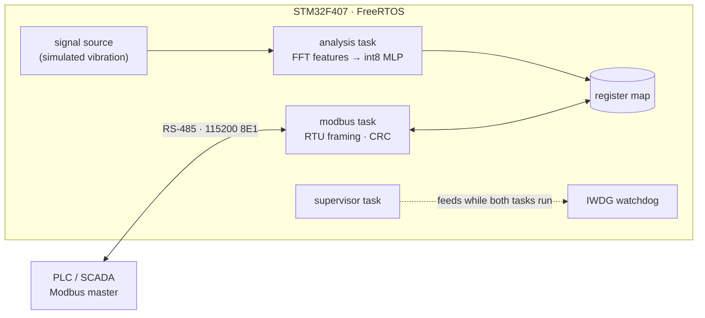

# vibration-monitor-node

[](https://github.com/PATEmbedded/vibration-monitor-node/actions/workflows/ci.yml)
[](LICENSE)

Firmware for a condition-monitoring node on rotating machines (motors, pumps, fans). It runs on an STM32F407 with FreeRTOS and analyses vibration on the device:

- It computes FFT and statistical features of each 0.1 s frame.
- A small int8 neural network uses those features to tell a **healthy** machine from **imbalance**, **misalignment** and a **bearing fault**.
- It reports the result and the measurements over **Modbus RTU**, the protocol PLCs and SCADA systems already speak.

Every commit is built and tested in CI, from unit tests on the PC to the real firmware binary running on an **emulated STM32F407** in [Renode](https://renode.io), where a Modbus client checks it end to end.

> **Status.** The vibration comes from a built-in signal model, not from a sensor, and the classifier is trained on synthetic data. The firmware has not been run on hardware yet. See [Limits](#limits).

## Architecture



| Task | Priority | Job |
|---|---|---|
| `modbus` | 3 | Collects bytes from the UART interrupt, ends a frame after a silent gap, answers it, and drives the RS-485 direction pin |
| `analysis` | 2 | Every interval (500 ms by default): acquires a frame, computes the features, classifies, and updates the input registers |
| `supervisor` | 1 | Feeds the independent watchdog only while both other tasks show progress, so a hung task resets the node |

The code is in three layers, and only the last one knows about the RTOS or the hardware:

| Layer | Contents | Tested on |
|---|---|---|
| `core/` | Portable C11: signal model, radix-2 FFT, features, int8 classifier, Modbus RTU server, CRC | PC, emulated MCU |
| `app/` | Node logic: settings with limits, register map, one analysis step | PC, emulated MCU |
| `firmware/` | Start-up, linker script, register-level board support (USART2, GPIO, IWDG), FreeRTOS tasks | emulated MCU |

## Signal processing and the model

Each frame has 1024 samples at 10,240 Hz (10 Hz per FFT bin). After removing the mean, the node computes:

| Features | Definition |
|---|---|
| level | log10 of RMS and of peak |
| shape | crest factor (peak / RMS), log10 of kurtosis (high for impulses) |
| harmonics | amplitude at 1×, 2× and 3× the shaft speed, relative to RMS (Hann window, ±1 bin) |
| spectrum | energy share in 8 bands from 0 to 5120 Hz |

The classifier is a 15–16–4 MLP:

- **Training.** It is trained with plain numpy (`tools/train.py`) on 6,000 synthetic frames. The shaft speed, amplitudes, noise and bearing resonance are randomised.
- **Quantisation.** Weights and activations are int8 with one scale per tensor, and the accumulators are int32. The hidden layer is requantised with an integer multiplier and shift, so the network itself uses no floating point.
- **Exactness.** The C inference must give exactly the same integer scores as the Python reference. CI checks this on more than 400 input vectors.

The signal model (`core/src/signal_sim.c`, mirrored in `tools/vmnlib.py`) is the sum of three parts:
- shaft harmonics;
- Gaussian noise;
- for a bearing fault, impulses at a multiple of the shaft speed, each ringing a decaying structural resonance.

On 1,000 fresh synthetic frames (`tools/evaluate.py`, seed 2026), the int8 model classified 999 correctly. This shows that the quantised C model behaves as trained. **It says nothing about accuracy on real machines.**

## Modbus register map

Slave address 1 by default, 115200 baud, 8 data bits, even parity, 1 stop bit. Function codes 0x03, 0x04, 0x06 and 0x10 are supported. A write of several registers is validated completely before anything changes. Broadcasts are executed and not answered.

**Holding registers** (read/write)

| Address | Name | Unit / range | Default |
|---:|---|---|---:|
| 0 | slave address | 1–247, applied after the reply | 1 |
| 1 | shaft speed | 0.1 Hz, 50–1000 | 250 |
| 2 | signal source | 0 healthy, 1 imbalance, 2 misalignment, 3 bearing fault (simulated) | 0 |
| 3 | analysis interval | ms, 100–10000 | 500 |

**Input registers** (read-only)

| Address | Name | Scale |
|---:|---|---|
| 0 | firmware version | 0x0100 = 1.0 |
| 1 | frames analysed | wraps at 65536 |
| 2 | class | 0 healthy, 1 imbalance, 2 misalignment, 3 bearing fault |
| 3 | confidence | per mille |
| 4, 5 | RMS, peak | × 1000 |
| 6, 7 | crest factor, kurtosis | × 100 |
| 8, 9, 10 | 1×, 2×, 3× amplitude | × 1000 |
| 11, 12, 13 | Modbus frames accepted, CRC errors, exceptions sent | count |
| 14 | UART receive overruns | count |

## Build and test

Requirements: CMake 3.20+, a C11 compiler, Python 3.10+ with numpy and pytest, the Arm GNU toolchain (`arm-none-eabi-gcc`) for the firmware, and [Renode](https://renode.io) for the system tests.

```sh
# Host: core, unit tests, command-line tool
cmake -S . -B build -DVMN_SANITIZE=ON
cmake --build build
ctest --test-dir build --output-on-failure
pip install -r tools/requirements.txt
VMN_CLI=build/vmn_cli python -m pytest test/python

# Firmware (set ARM_TOOLCHAIN_DIR if arm-none-eabi-gcc is not on PATH)
cmake -S firmware -B build-fw
cmake --build build-fw            # build-fw/vmn-node.elf and .bin

# The firmware on an emulated STM32F407
RENODE=/path/to/renode python -m pytest test/renode -v

# Retrain the model and regenerate the C header
python tools/train.py && python tools/export_header.py
```

The firmware build downloads pinned versions of FreeRTOS-Kernel (MIT), CMSIS 6 (Apache-2.0) and ST's STM32F4 device files (Apache-2.0); the unit tests download Unity (MIT). None of them is copied into this repository.

## How it is tested

| Level | What runs | Where |
|---|---|---|
| Unit | Unity tests of every core module and of the register map; gcc and clang with AddressSanitizer and UndefinedBehaviorSanitizer | CI, PC |
| Reference | C features against numpy, within float tolerance; int8 scores identical to the Python model | CI, PC |
| Model | Accuracy on fresh synthetic data must stay at 95 % or more; the C header must match `model/model.json` | CI |
| Fuzzing | libFuzzer on the Modbus server for 2 minutes, with and without a valid CRC | CI |
| Static analysis | cppcheck on the portable code; all project C files built with `-Wall -Wextra -Wpedantic -Werror` | CI |
| System | The firmware ELF on an emulated STM32F407. A Modbus client checks that each condition is classified, the register limits, exceptions, bad CRCs, broadcasts, the address change, and that the watchdog does not reset a healthy node | CI, PC |

## Project layout

```
core/          portable C11 library (headers in core/include/vmn)
app/           node logic: register map and analysis step
firmware/      STM32F407: CMake project, linker script, board support, FreeRTOS tasks
model/         model.json (trained) and model_data.h (generated from it)
tools/         Python reference, training, header export, evaluation, vmn_cli
test/host/     Unity unit tests
test/python/   C code against the Python reference
test/renode/   Renode script and system tests
fuzz/          libFuzzer target
```

## Limits

- **No sensor yet.** The signal source is the built-in model. A real node needs an accelerometer driver (for example over SPI) as another value of holding register 2.
- **Synthetic training data.** The model has not seen a real machine. Real vibration would need a recorded data set and new training.
- **Not run on hardware.** It has only run on the emulated STM32F407. Renode does not model the 9-bit word that carries the parity bit, so parity is only checked on hardware.
- **Not measured.** Inference time, CPU load and current consumption have not been measured. The linker reports about 29 KB of flash and 44 KB of RAM for v1.0.0.
- **Frame timing uses the RTOS tick.** A frame ends after 3 ms of silence, which covers the 1.75 ms that Modbus RTU requires above 19200 baud.

## License

MIT. See [LICENSE](LICENSE).
